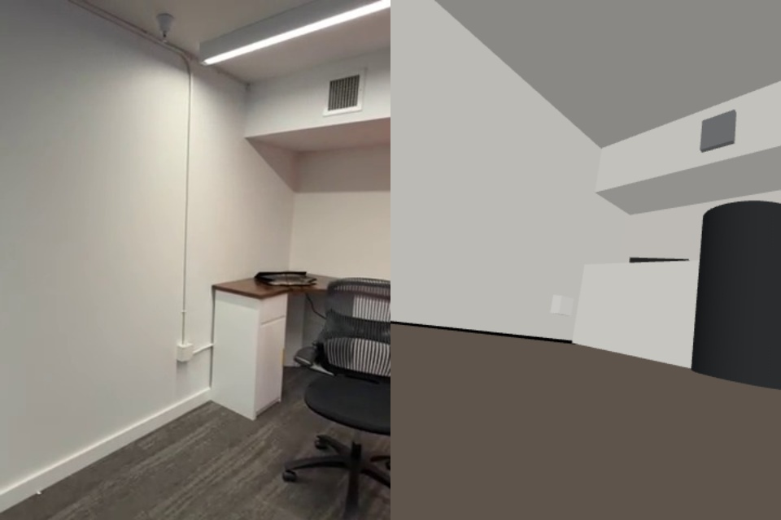

<div align="center">

# Reality Engine

**Film a space. Get a measured, editable, simulatable 3D replica.**


`video → stable frames → measured camera path + 3D points → Gemini reads the whole video → parallel zone agents build objects → render-and-critique loop → CAD editor`

</div>

Built at the **Gemini 4 Argon SF Hackathon** (2026-10-25), Track 2: *More Dimensions*. Everything here was written during the event.

## Contents
- [What it does](#what-it-does)
- [Results on a real video](#results-on-a-real-video)
- [Status](#status)
- [Quick start](#quick-start)
- [How it works](#how-it-works)
- [The CAD editor](#the-cad-editor)
- [Configuration](#configuration)
- [CLI and HTTP API](#cli-and-http-api)
- [Repository map](#repository-map)
- [Testing](#testing)
- [Limits](#limits)
- [Privacy and security](#privacy-and-security)
- [Contributing](#contributing)
- [License](#license)

## What it does

Turning a real place into a 3D world (for robot simulation, layout planning, digital twins) usually means one of two things: hours of manual CAD work, or a photoreal splat you can't edit or simulate. Reality Engine sits between them. It produces **named objects with real dimensions, sitting in a frame measured from the video**, that you can edit like CAD and export to a simulator.

- **Measured geometry, no AI.** OpenCV structure-from-motion recovers where the camera was for every stable frame, plus a coloured 3D point cloud, a floor plane and the scale.
- **Understanding, with Gemini 4 Argon.** Argon watches the entire video in one context, then **one agent per zone runs in parallel**. Each agent forks that reading, so the whole video is already in its context, and gets its zone's per-second stable frames, their measured camera poses and the 3D points each camera can see. It places objects against those measurements.
- **A render, watch, critique, fix loop.** The replica is rendered from every keyframe camera. Each agent sees its own REAL | REPLICA comparison and corrects its objects.
- **A CAD editor in the browser.** Gizmos, snapping, exact dimensions, measuring, calibrating scale from a known length, fitting a box to the point cloud, viewing through any keyframe with the real photo overlaid, and export to glTF and MuJoCo.

Gemini never invents geometry. Cameras, points and floor are always measured, and the model only decides *what* is where.

## Results on a real video

A 14-second handheld iPhone clip of an office corner (360×480, portrait, variable frame rate), run end to end
with the Gemini key:



*Left: the real stable frame at t ≈ 7 s. Right: the replica rendered from that frame's measured camera pose.*

| Stage | Result |
|---|---|
| Stable frames | 15 per-second keyframes, 57 geometry frames (best of 8 candidates per second, in ¼ s windows) |
| Geometry | 41 of 57 frames registered, 794 coloured 3D points, floor found |
| Argon reading (whole video, one context) | 1 zone, 11 objects seen, text read ("DANGER", "Y") |
| Zone agent + 2 critique rounds | 16 objects: phone booth and its interior, bar stool, booth desk shelf, orange cube, white door, office chair, corner desk, desk organizer tray, air vent grille, wall junction box, power outlet, back wall, left wall, ceiling soffit, ceiling slab |
| Verify | Mean SSIM 0.68 against the real frames; 24% of measured points lie on a replica surface |

What this shows honestly:
- The understanding is good: every major object in the corner is named and placed.
- The geometry is coarse. Positions and the floor line are visibly off in the render above.
- Before this run, one frame per second registered only 7 of 15 frames on this clip, which is why reconstruction now
  uses denser frames.
- The editor is where you refine the result: fit to points, snap, measure, and calibrate scale from a known length.

On the synthetic test room, which has ground truth, the same pipeline went from 21% to 94% of points on a surface
after the agents built the room, with a camera path accurate to 8 mm.

## Status

| Area | State |
|---|---|
| Stable-frame selection (per-second keyframes + 4/s geometry frames) | Implemented, tested |
| Structure-from-motion, floor (cameras-above check), scale prior | Implemented, tested against ground truth |
| Scene contract (pydantic, validated on every write) | Implemented, tested |
| Gemini: full-video reading, parallel zone agents, critique rounds | Implemented, **run live** on a real phone video |
| Verify: render from every keyframe camera, SSIM, edge F1, points on a surface | Implemented, tested |
| Local server: upload, pipeline, ETag-checked saves, verify, exports | Implemented, tested |
| CAD editor | Implemented, checked in a browser |
| Managed Agents for zone agents, bundle adjustment, in-editor physics | Roadmap |

The design is in [SPEC.md](SPEC.md). An independent review and the list of fixes is in [docs/REVIEW_BRIEF.md](docs/REVIEW_BRIEF.md).

## Quick start

Requires Python 3.11+, [uv](https://docs.astral.sh/uv/) and a browser. The editor loads three.js from jsDelivr.

```powershell
git clone https://github.com/ayushozha/reality-engine.git
cd reality-engine
uv sync
Copy-Item .env.example .env      # add GEMINI_API_KEY (optional: geometry and the editor work without it)
uv run python -m engine.server
```

Open **http://127.0.0.1:8765**, click **Add video**, and pick a clip. A slow pan with some sideways movement works best. Stage progress shows in the header. When the scene stage finishes, the camera path, point cloud and keyframe strip appear. When the Gemini stages finish, the objects appear.

Headless:

```powershell
uv run python -m engine.pipeline --video C:\path\to\walkthrough.mov
```

## How it works

```
               ┌──────────────── measured (OpenCV, no AI) ────────────────┐
 video ──► stable frames ──► SIFT ─► essential-matrix init ─► PnP per frame ─► triangulate
   │       (8 scored per s;                                              │
   │        best per second +                                            ▼
   │        best per ¼ s)                    floor (RANSAC, cameras above) → y = 0, +Y up, 1.5 m height prior
   │                                                                     │
   │            ┌────────────── Gemini 4 Argon (needs a key) ────────────┤
   └──────────► │ read: whole video, one context → zones, objects, text, lights
                │ build: one agent per zone, in parallel, forking the reading;
                │        input = its stable frames as a 1 fps clip + camera poses + visible 3D points
                │ critique: REAL | REPLICA clip per zone → corrected objects (N rounds)
                └──────────────────────────────┬─────────────────────────┘
                                               ▼
                              scene.json ◄──► CAD editor (three.js) ──► glTF / MuJoCo MJCF
                                               │
                              verify: MuJoCo render from every camera → SSIM, edge F1, points on a surface
```

| Stage | Output |
|---|---|
| `keyframes` | `keyframes/` (one stable frame per second) and `geoframes/` (one per ¼ s), each with every candidate's sharpness and motion scores |
| `geometry` | Camera pose per geometry frame, `points.json` (coloured 3D points), floor plane |
| `scene` | `scene.json`: cameras, floor, calibration, objects |
| `read` | `reading.json`: zones with time ranges, objects with first and last seen times, text, lights |
| `build` | `agents.json`, plus objects in `scene.json` |
| `critique` | Corrected objects, N rounds |
| `verify` | `verify.json` and `renders/*_compare.jpg` |

## The CAD editor

| Action | How |
|---|---|
| Move / rotate / scale | **W / E / R** or the toolbar; world or local axes |
| Snap | 1, 5, 10 or 25 cm, and 15° |
| Exact values | Properties panel, in metres and degrees |
| Add, duplicate, delete | Left panel, **Ctrl+D**, **Delete** |
| Undo / redo | **Ctrl+Z / Ctrl+Y** |
| Drop to floor, fit to points | Toolbar. *Fit to points* snaps a box to the reconstructed points inside it. |
| Measure, set scale | **M**, then click two points; enter the true length and **Set scale** |
| Match to the video | Click any keyframe to view through its camera with the real photo overlaid |
| Verify | Renders every keyframe and lists the worst matches first |
| Save, export | **Ctrl+S**; **Export glTF** (.glb, in metres); **Export MJCF** (MuJoCo, in metres) |

Saves are checked against the server's copy with an ETag. If the pipeline has changed the scene since you loaded it, the save is refused and **Reload scene** appears instead of silently overwriting. Editing a Gemini-built object makes it yours, so a rebuild keeps it. A rebuild also maps your objects and a measured calibration into the new reconstruction.

## Configuration

`.env` in the project root (see [.env.example](.env.example)). Values in `.env` override the shell, and a blank value unsets a variable.

| Variable | Default | Effect |
|---|---|---|
| `GEMINI_API_KEY` | none | Enables the read, build and critique stages. Without it they're marked *skipped* and everything else runs. |
| `GEMINI_MODEL` | none | Model for reading and critique, e.g. `gemini-4-argon` |
| `GEMINI_AGENT_MODEL` | `GEMINI_MODEL` | Model for the parallel zone agents |

Pipeline flags:

| Flag | Default | Effect |
|---|---|---|
| `--per-second` | 8 | Candidate frames scored per second |
| `--hfov` | 65 | Camera horizontal field of view, in degrees |
| `--max-keyframes` | 400 | Cap on geometry frames used for reconstruction |
| `--rounds` | 2 | Critique rounds |

## CLI and HTTP API

| Command / route | Purpose |
|---|---|
| `python -m engine.server [--port 8765]` | Editor and API, bound to 127.0.0.1 |
| `python -m engine.pipeline --video F [--run ID]` | Full pipeline without the editor |
| `POST /api/runs` (raw body, `X-Filename`) | Upload a video and start a run |
| `GET /api/runs`, `GET /api/runs/{id}/status` | Runs and stage progress (includes `scene_etag`) |
| `GET /api/runs/{id}/scene` | Scene, with an `ETag` header |
| `PUT /api/runs/{id}/scene` + `If-Match` | Save. Responds 412 if the scene is stale, 409 while the run is busy |
| `POST /api/runs/{id}/verify`, `POST /api/runs/{id}/rebuild` | Verify, or rerun the pipeline |
| `GET /api/runs/{id}/scene.mjcf` | MuJoCo export, in metres |

## Repository map

| Path | Role |
|---|---|
| `engine/keyframes.py` | Stable-frame selection (windows per second, candidate scores) |
| `engine/sfm.py` | Structure-from-motion, floor fit, alignment |
| `engine/scene.py` | Scene contract (pydantic) and atomic writes |
| `engine/understand.py` | Gemini: whole-video reading, parallel zone agents, critique |
| `engine/llm.py` | Interactions API wrapper (background calls, JSON schema, chaining, video upload) |
| `engine/verify.py` | Render-and-compare, points on a surface |
| `engine/mjcf.py` | Scene → MuJoCo MJCF (Y-up → Z-up, a camera per keyframe) |
| `engine/pipeline.py` | Stage runner, status, rebuild carry-over |
| `engine/server.py` | Local HTTP server |
| `web/` | CAD editor (three.js 0.186.1) |
| `tests/` | 24 tests; `synthetic.py` renders a room with known camera poses for them |
| `docs/REVIEW_BRIEF.md` | Claims, the independent review, and the fixes |

## Testing

```powershell
uv run pytest -q     # 24 passed
```

The tests render a textured room with MuJoCo along a known camera path, then check:
- **Keyframes:** blurred frames are never chosen, and frames stay inside their second at 29.97 fps.
- **Camera path:** within 3 cm of ground truth after a similarity fit (measured: 8 mm mean). This checks shape; absolute scale comes from the height prior.
- **Floor:** it is found, and a ceiling is never taken as the floor.
- **Scene contract:** it rejects bad input.
- **MuJoCo export:** axes, rotations and metric export are correct.
- **Verify:** placing the true table raises both scores, and each camera renders at its own aspect.
- **Server:** saves need a current ETag and an idle run, it refuses path traversal, and every upload gets its own run id.
- **Gemini wiring (mocked):** upload failures raise, blank `.env` values unset the variable, and occluded points are dropped.

## Limits

- Not every video works. Reconstruction needs overlap and sideways camera motion. There's no bundle adjustment, so drift grows on long paths.
- Objects are boxes, round cylinders, spheres and planes: a structured replica, not a photoreal or millimetre-exact copy.
- Scale comes from a 1.5 m camera-height prior until you calibrate with a known length in the editor.
- Focal length is assumed (65° horizontal field of view; set `--hfov` to override).
- Variable-frame-rate phone videos are timed at their declared average rate.
- This build's Gemini key has image input disabled, so frames are sent to the agents as short 1 fps clips.
- COLMAP would be a stronger reconstruction backend, but Windows Application Control blocked its native library on the build machine.

## Privacy and security

- Videos and everything derived from them stay in `runs/` (gitignored).
- With a key set, the video, stable frames and point samples are sent to the Gemini API.
- The server binds to 127.0.0.1 only, validates every scene write, confines file reads to the run folder, and holds one writer per run at a time.

## Contributing

Keep these invariants:
- Geometry comes from measurement, never from the model.
- Every scene write goes through `engine/scene.py`.
- Model IDs come from env, never code.
- No sample or demo data ships with the app.
- `uv run pytest -q` stays green.

## License

No license file is checked in yet.
